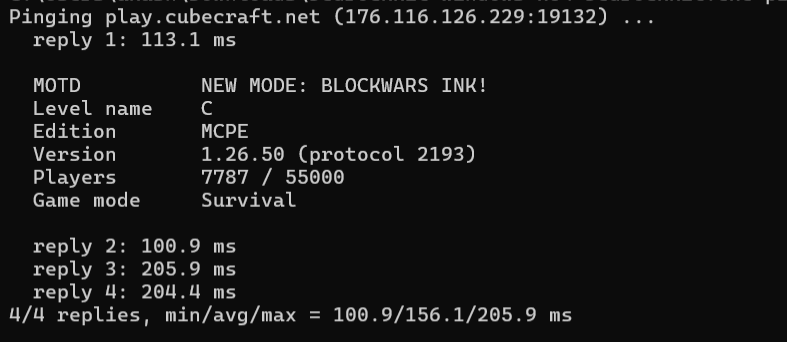

# bedrockkit

A dependency-free C++17 command-line toolkit for **Minecraft: Bedrock Edition**.
Runs on Windows, Linux, and macOS.

| Command | What it does |
|---|---|
| `ping` | Queries a Bedrock server: MOTD, player count, version, game mode, latency |
| `level` | Reads a world's `level.dat` and edits values safely (auto-backup) |
| `nbt` | Dumps any NBT file (little- or big-endian) as readable SNBT |
| `sample` | Generates a sample `level.dat` to experiment with |
| `serve` | Mock server that answers server-list pings, for testing |

## Download

Grab the latest build for your system from the [Releases page](https://github.com/glyphwraith/bedrockkit/releases).
On Windows, extract the zip and run `bedrockkit.exe` from a terminal.

> Windows may show a SmartScreen warning because the exe is unsigned. Click **More info → Run anyway**.

## Build from source
```bash
cmake -B build
cmake --build build --config Release
```
The binary is `build/bedrockkit` (or `build/Release/bedrockkit.exe` with Visual Studio).

## Usage

### Ping a server
```bash
bedrockkit ping play.cubecraft.net            # default port 19132
bedrockkit ping play.cubecraft.net 19132 --count 6 --raw
```



Bedrock uses **UDP**, so this works even when a TCP port checker says the server is down.
Formatting codes in the MOTD are stripped for display (`--raw` shows the original).

### Inspect and edit a world
Your worlds live in `com.mojang/minecraftWorlds/<world>/level.dat`.
```bash
bedrockkit level level.dat                       # friendly summary
bedrockkit level level.dat --dump                # every tag
bedrockkit level level.dat --get experiments     # one tag
bedrockkit level level.dat --set GameType=1 --set LevelName="My World" --set commandsEnabled=true
```
Editing keeps each tag's original type, range-checks numbers, and writes `level.dat.bak` first.
Close Minecraft before editing a live world.

### Dump any NBT
```bash
bedrockkit nbt structure.mcstructure
bedrockkit nbt level.dat --skip 8        # skip the 8-byte Bedrock level.dat header
bedrockkit nbt java_file.nbt --big-endian
```

### Test without a server
```bash
bedrockkit serve --port 19132 --motd "My Test Server" --players 7
# in another terminal:
bedrockkit ping 127.0.0.1
```
`serve` only answers server-list pings. It is not a playable server.

## Layout
```
include/bedrockkit/nbt.hpp     NBT parser, writer, SNBT printer, path edit helpers
include/bedrockkit/raknet.hpp  RakNet unconnected ping/pong packets + MOTD parsing
include/bedrockkit/net.hpp     cross-platform UDP sockets (Winsock / BSD)
src/main.cpp                   command-line interface
```

## How it works
- **NBT**: Bedrock stores data as little-endian NBT (Java uses big-endian). The parser handles all 12 tag
  types with bounds checking and a depth limit, so corrupt files produce errors instead of crashes.
- **level.dat**: an 8-byte header (storage version + payload length, both little-endian int32) followed by NBT.
  The header is rebuilt on save.
- **Ping**: the client sends RakNet packet `0x01` containing a timestamp, a 16-byte magic constant, and a
  client GUID. The server answers with `0x1C` carrying a semicolon-separated string
  (`MCPE;MOTD;protocol;version;players;max;guid;level;gamemode;...`).

## Ideas for extending
- Read chunk data from the world's LevelDB database
- `.mcstructure` and `.mcworld`/`.mcpack` (zip) support
- Parse player data and inventories
- Full RakNet connection handshake
- JSON output for scripting

## License
MIT
